 

---

## 👋 Sobre mim

Tenho 19 anos, moro em São Paulo e **curso Ciência da Computação na UNICID**. Meu foco é o **desenvolvimento front-end**: gosto de transformar ideias em interfaces, aprender na prática e registrar cada etapa dessa jornada aqui no GitHub. Busco meu primeiro **estágio em front-end** e pretendo avançar para o back-end em seguida.

- 🎯 **Objetivo:** conquistar um estágio em desenvolvimento front-end
- 🔭 **Estudo agora:** JavaScript, Git e GitHub (branches e pull requests) e modelagem de banco de dados
- 🚀 **Próximos passos:** React e TypeScript, depois back-end
- 🔁 **Rotina:** pratico quase todos os dias e acompanho minha evolução pelos commits
- 🤝 **Jeito de trabalhar:** aprendo rápido com o time, peço feedback e ajusto o caminho
- 🌍 **Meta de longo prazo:** trabalhar remotamente, em projetos internacionais

---

## 🛠️ Tecnologias

Meu foco é o front-end, e é nele que concentro minhas ferramentas.

**Front-end (meu dia a dia)**

  

- **HTML5 e CSS3** para estruturar e estilizar as interfaces
- **JavaScript** para dar comportamento e interação às páginas

**Versionamento e ambiente de trabalho**

  

- **Git e GitHub** para versionar o código e colaborar com a equipe
- **VS Code** como editor

**Próximos destinos (em estudo)**

  

- **React** para construir interfaces em componentes
- **TypeScript** para escrever JavaScript mais seguro e fácil de manter

> Também tenho conhecimento em outras linguagens (C, Java e Python), que reforçam minha base de lógica de programação, mas é no JavaScript que concentro meu foco.

---

## 🥈 Hackathon WECTI 2026 (UNICID) — 2º lugar

**Desenvolvedor back-end · Equipe Hackathonicos**

Na 6ª edição da WECTI, a **Hackathonicos conquistou o 2º lugar** no hackathon, e tenho muito orgulho de ter feito parte dessa equipe. Atuei como **desenvolvedor back-end**, responsável pelo banco de dados e pela lógica do processo de uma solução para um problema real: a **gestão de catálogo e estoque de lojistas que vendem em vários marketplaces** (como Mercado Livre, Shopee, Magalu e TikTok Shop).

**O que eu fiz**
- **Atuei no back-end** da solução, estruturando o banco de dados e a lógica que sustenta o sistema
- **Colaborei com um time de papéis definidos** (liderança, back-end, front-end e integrações), alinhando a integração entre as partes
- **Construí e entreguei um MVP em poucos dias**, entre a abertura (28/09) e a submissão (30/09)
- **Apresentei a solução** em um pitch de 10 minutos, seguido de 5 minutos de arguição da banca
- **Evoluí com as mentorias** do evento, aplicando o feedback ao protótipo

**Por que essa experiência pesa no meu currículo**
- Trabalhei em um **projeto de ponta a ponta**, da definição do problema ao pitch final
- Fui avaliado por critérios técnicos e de negócio: **aderência à dor, inovação, exequibilidade técnica (MVP funcional) e qualidade do pitch**
- Pratiquei o **trabalho sob prazo curto** e a **divisão de responsabilidades** de uma equipe de desenvolvimento
- Tive **contato direto com mentores** e com um processo seletivo e de avaliação parecido com o de um ambiente profissional
- Exercitei o **versionamento em equipe** com Git e GitHub em um repositório colaborativo

> 💬 O código do projeto fica em um repositório privado da equipe. Terei prazer em contar mais sobre a solução e sobre a minha participação em uma conversa.

---

## 🚀 Projeto em destaque

| Projeto | O que é | Tecnologias |
| ------- | ------- | ----------- |
| [Batuque](https://github.com/gioribeirro/Trabalho-Luis-Batuque) | Projeto em equipe: site avaliador de músicas e álbuns, que aproxima amantes de música e de vários gêneros, com resenhas, biblioteca de álbuns e estatísticas de escuta. Atuo como contribuidor e desenvolvedor front-end | HTML, CSS, JavaScript |

**Batuque: como eu atuo**
- **Atuo como desenvolvedor front-end** da equipe, cuidando da interface do site
- **Desenvolvo as telas** em HTML, CSS e JavaScript, em arquivos separados, seguindo o wireframe do time
- **Aprendo na prática** o fluxo de trabalho em equipe com Git e GitHub
- **Evoluo o código** a cada atualização, buscando manter a interface consistente e organizada

---

## 🎓 Formação

**Bacharelado em Ciência da Computação** · UNICID, campus Tatuapé · em andamento

---

## 📫 Vamos conversar?

Estou aberto a oportunidades de **estágio em front-end**. Fale comigo pelo [LinkedIn](https://www.linkedin.com/in/kevyn-morais-1ba330291/) ou por [e-mail](mailto:kevynmorais721@gmail.com).

